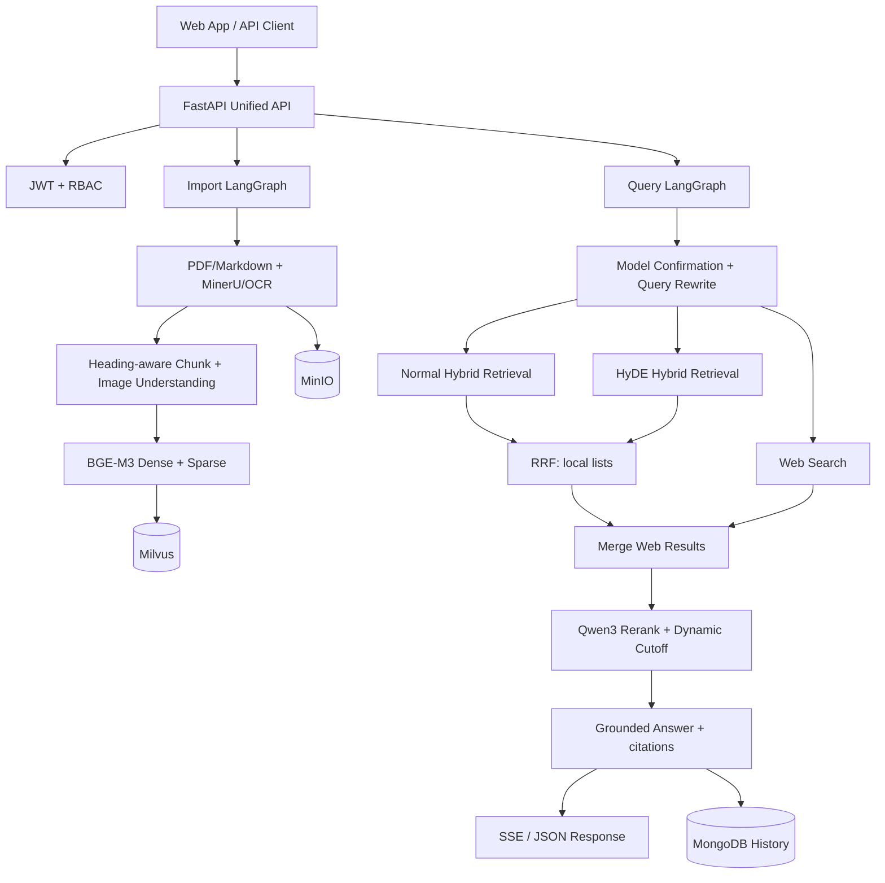

# Zhiku Enterprise RAG

面向设备说明书、运维手册和售后知识的企业级 RAG 平台。项目提供文档导入、混合检索、RRF 融合、二阶段精排、带 `[n]` 引用的回答、SSE 输出、会话历史、JWT/RBAC、离线评测、Docker 和 CI。

默认 `standalone` 独立运行模式无需 API Key、GPU 或数据库，克隆后即可完整体验；`full` 模式连接原始 LangGraph、BGE-M3、Milvus、MongoDB、MinIO、MinerU 和模型服务。

## 30 秒体验

### Docker（推荐）

```bash
docker compose up --build
```

浏览器访问：

- 应用页：<http://localhost:8000/app>
- Swagger：<http://localhost:8000/docs>
- 健康检查：<http://localhost:8000/health/ready>

### 本地 Python

```bash
python -m venv .venv
# Windows: .venv\Scripts\activate
# macOS/Linux: source .venv/bin/activate
python -m pip install -r requirements-standalone.txt
uvicorn app.main:app --host 0.0.0.0 --port 8000
```

默认会导入 `examples/` 中 3 份明确标注为“合成数据”的示例手册。可直接提问：

- `HAK-180 最高工作温度是多少？`
- `E07 表示什么，应该如何处理？`
- `LA2608 恢复出厂设置要按 RESET 多久？`

## 为什么设计双模式

| 模式 | 目标 | 检索与生成 | 外部依赖 |
|---|---|---|---|
| `standalone`（默认） | 独立运行、GitHub 可复现、接口联调、测试与评测 | 稳定哈希稠密向量 + BM25 → RRF → 词法精排 → 抽取式引用回答 | 无 |
| `full` | 展示真实 RAG 生产链路 | BGE-M3 稠密/稀疏混合检索（普通 + HyDE）→ 本地 RRF → 合并联网结果 → Qwen3 Rerank → LLM 引用回答 | Milvus、MongoDB、MinIO、MinerU、模型 API |

两个模式共享统一 API 契约。`standalone` 是可独立运行和重复验证的工程形态，用于验证 API、检索、引用、评测与工程治理；`full` 模式接入真实模型和基础设施，提供完整语义能力。

## 系统架构



重要实现事实：联网结果不进入本地 RRF；RRF 只融合普通检索和 HyDE 两路本地结果，联网结果随后合并并一起进入 Reranker。可编辑架构图见 [`docs/assets/zhiku-architecture.drawio`](docs/assets/zhiku-architecture.drawio)。

## 核心能力

- 统一 FastAPI 入口：文档、查询、SSE、历史、评测、健康检查。
- 同步重型工作流通过 `asyncio.to_thread()` 移出事件循环，避免阻塞其他请求。
- PDF/Markdown 导入，MinerU 解析，标题感知切分，图片理解和对象存储。
- BGE-M3 稠密与稀疏向量、Milvus 混合检索、HyDE、RRF 和二阶段精排。
- 回答与来源一同返回；Prompt 约束关键结论使用真实 `[n]` 引用。
- JWT HS256、viewer/admin RBAC、安全 CORS、上传类型/大小/文件名约束。
- MongoDB、MinIO 懒连接；MinIO 默认私有，公开读取仅在本地完整栈显式开启。
- JSON 请求日志、Request ID、liveness/readiness、75% CI 覆盖率门槛和密钥模式扫描。

## API 概览

| 方法 | 路径 | 作用 | 权限 |
|---|---|---|---|
| `GET` | `/health/live`、`/health/ready` | 存活与依赖就绪检查 | 公开 |
| `POST` | `/api/v1/auth/token` | 获取 JWT | 公开 |
| `POST/GET/DELETE` | `/api/v1/documents` | 导入、列表、删除文档 | admin / viewer / admin |
| `POST` | `/api/v1/query` | 非流式问答与结构化来源 | viewer |
| `POST` | `/api/v1/query/stream` | SSE 问答 | viewer |
| `GET/DELETE` | `/api/v1/sessions/{id}/history` | 会话查询与清理 | viewer / admin |
| `POST` | `/api/v1/evaluations/benchmark` | 执行确定性基准评测 | admin |

完整请求示例见 [`docs/API.md`](docs/API.md)。默认演示关闭认证；部署时设置 `AUTH_ENABLED=True`，生产环境会拒绝默认 JWT 密钥和默认管理员密码。

## 可复现评测

```bash
python scripts/evaluate.py --top-k 5 --output reports/evaluation-standalone.json
```

当前固定的 8 条合成回归数据结果：

| 指标 | 结果 |
|---|---:|
| Recall@5 | 1.0000 |
| MRR | 1.0000 |
| Answer keyword coverage | 1.0000 |
| Citation coverage | 1.0000 |
| Heuristic groundedness | 1.0000 |

这些数值只证明当前小型合成数据集上的可重复回归，不代表真实业务准确率；`heuristic_groundedness` 是词元支持率代理，不是 RAGAS Faithfulness 或 LLM Judge。方法、数据限制和扩展方式见 [`docs/EVALUATION.md`](docs/EVALUATION.md)。

## 质量证据

```bash
python -m ruff check app scripts tests
python -m pytest --cov=app --cov-report=term-missing --cov-fail-under=75
python scripts/check_secrets.py
docker compose -f docker-compose.yml config --quiet
```

本地已验证：9 个轻量单元/API 测试通过，1 个需要完整外部依赖的旧链路测试按条件跳过，`app` 总覆盖率 79%。GitHub Actions 会重复执行 Lint、密钥检查、测试覆盖率、离线评测和 Compose 配置验证。

## 完整模式

```powershell
Copy-Item .env.example .env
# 在本地 .env 填写模型和 MinerU 凭据，不要提交
docker compose -f docker-compose.full.yml up --build
```

完整镜像包含模型依赖，首次构建和模型下载明显慢于演示模式。部署前请阅读 [`docs/DEPLOYMENT.md`](docs/DEPLOYMENT.md) 与 [`docs/SECURITY.md`](docs/SECURITY.md)。

## 项目结构

```text
app/                         统一 API、双模式服务、鉴权与评测
processor/import_processor/ 原始文档导入 LangGraph
processor/query_processor/  原始查询 LangGraph
examples/                    合成手册与固定评测集
scripts/                     评测和密钥安全检查
tests/                       单元、API 与旧链路回归测试
web/page/showcase.html       无外部前端依赖的演示页
docs/                        架构、API、部署、评测、面试材料
.github/workflows/ci.yml     持续集成
```

## 文档导航

- [`docs/ARCHITECTURE.md`](docs/ARCHITECTURE.md)：两条 LangGraph 链路和关键设计取舍
- [`docs/API.md`](docs/API.md)：接口与 curl 示例
- [`docs/DEPLOYMENT.md`](docs/DEPLOYMENT.md)：standalone/full 部署与排障
- [`docs/EVALUATION.md`](docs/EVALUATION.md)：评测口径与限制
- [`docs/SECURITY.md`](docs/SECURITY.md)：密钥、上传、CORS、对象存储与生产清单
- [`docs/INTERVIEW_GUIDE.md`](docs/INTERVIEW_GUIDE.md)：简历表述、项目讲法和追问
- [`docs/PROJECT_EVIDENCE.md`](docs/PROJECT_EVIDENCE.md)：功能到代码/测试/评测证据映射
- [`docs/RESUME_ALIGNMENT.md`](docs/RESUME_ALIGNMENT.md)：当前简历必须纠正与待验证的口径

## License

[MIT](LICENSE)。示例手册均为项目合成数据，不对应真实厂商文档。
